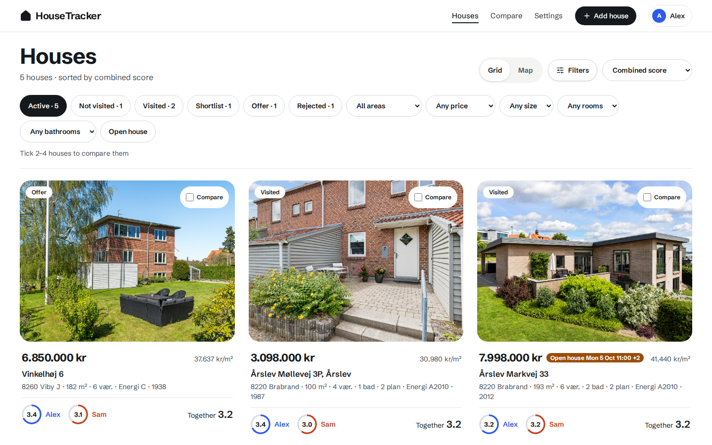
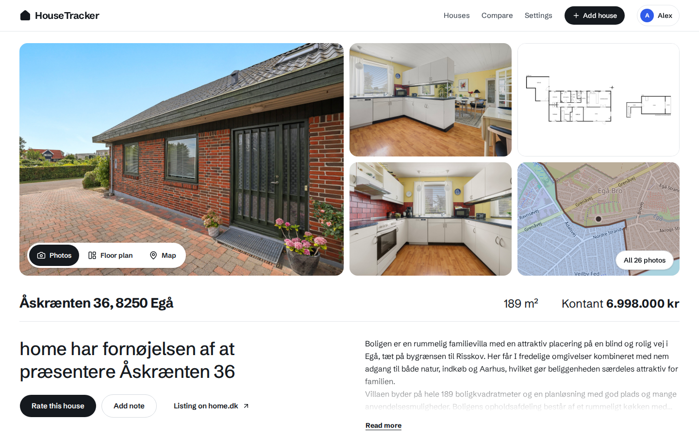
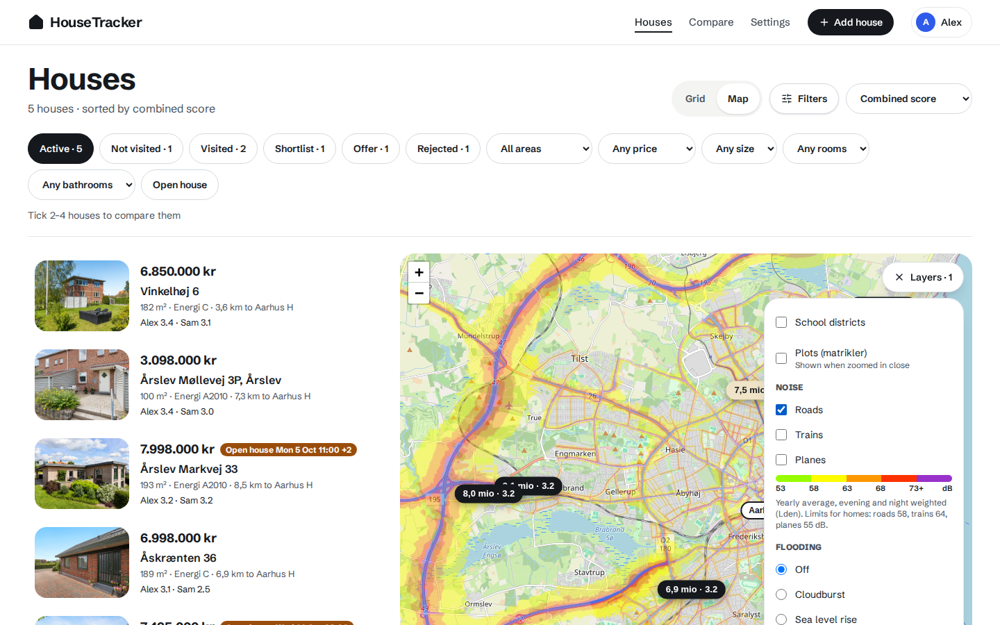
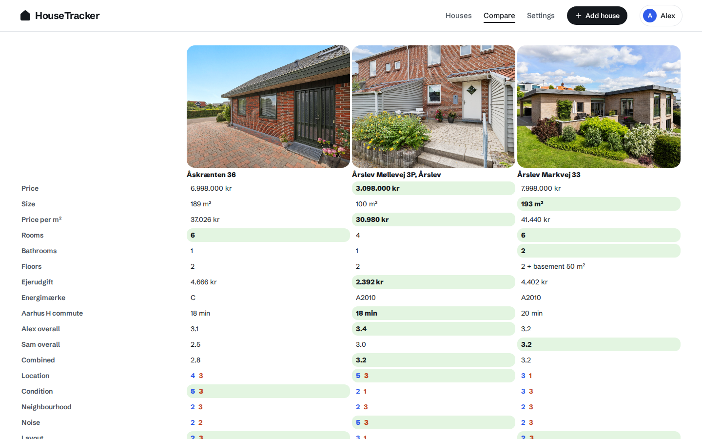
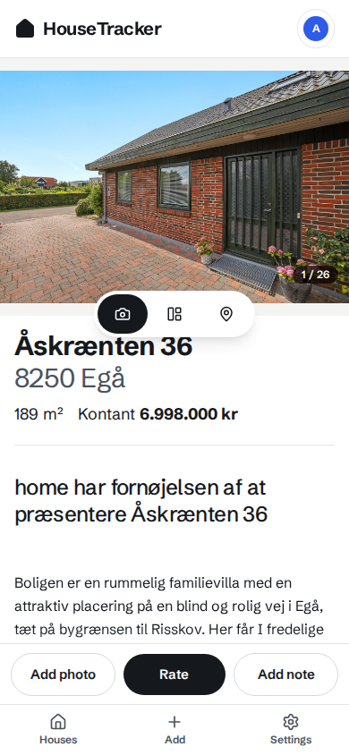
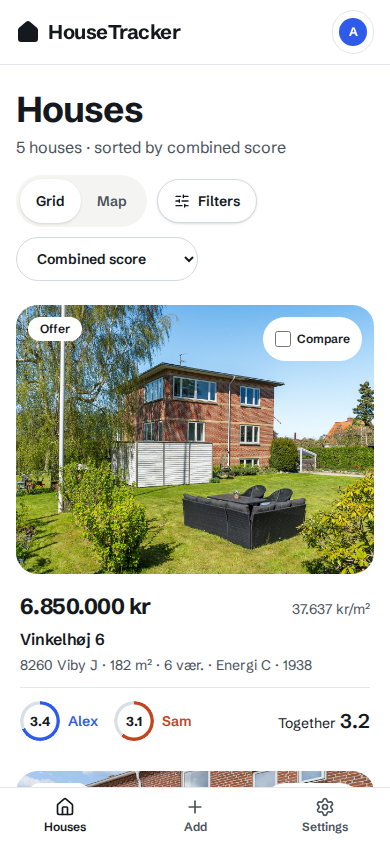

# HouseTracker

A self-hosted house-hunting tracker for couples (or any small group) buying in Denmark.
Paste a realtor link and it captures the listing, photos and price; scores each visit per
person; and enriches every house with Danish public data: commute times, the school
district and its schools, noise, flood and cloudburst maps, plots, sun, price history,
open houses and sold detection.

| Houses | House page | Map | Compare |
|---|---|---|---|
|  |  |  |  |

On the phone:

 

## What you need

- A Linux box that stays on (a home server or a small VM), Python 3.12+, Node 24.
- Tailscale (recommended) or a private LAN. **There is no login**: anyone who can reach
  the port can use the app. Bind it to a Tailscale or LAN address, never the open internet.
- Free keys, in `~/.config/housetracker.env` (mode 600):
  - `HT_ORS_KEY` — openrouteservice.org (commute and school walk/bike times).
  - `HT_DATAFORSYNINGEN_TOKEN` — dataforsyningen.dk (plots and cloudburst map layers).
  - `HT_DISCORD_WEBHOOK` — optional: price drops and new open houses posted to a channel.
  - `HT_ADV_TOKEN` — optional: a personal Adressevask token (a shared demo token is the default).

## Install

    git clone https://github.com/borgi-s/HouseTracker-public.git ~/HouseTracker
    cd ~/HouseTracker
    python3 -m venv .venv
    .venv/bin/pip install -e '.[api,scrape,dev]'
    .venv/bin/patchright install chromium        # browser fallback for walled realtor sites
    (cd web && npm ci && npm run build)
    .venv/bin/python -m pytest -q                # optional: should be green

Settings (`~/.config/housetracker.env`, `chmod 600`):

    HT_HOST=100.x.y.z                  # your Tailscale (or LAN) IP: the only address it listens on
    HT_APP_URL=http://myserver:8765    # what links in Discord messages point to
    HT_ORS_KEY=...
    HT_DATAFORSYNINGEN_TOKEN=...

Run it as a user service:

    mkdir -p ~/.config/systemd/user
    cp systemd/* ~/.config/systemd/user/
    systemctl --user daemon-reload
    systemctl --user enable --now housetracker-api.service housetracker-lifecycle.timer
    loginctl enable-linger "$USER"     # keep it running when you log out

Open `http://<HT_HOST>:8765`, add yourselves on the "Who are you?" screen, and add houses
from the Add page. Without systemd: `.venv/bin/python -m housetracker serve --host 127.0.0.1`.

## Your commute anchor

Commute times and the "km to" line are measured to a fixed anchor (work, a station,
grandparents). Add one once:

    curl -X POST http://<HT_HOST>:8765/api/anchors -H 'content-type: application/json' \
      -d '{"label": "Work", "address": "Rådhuspladsen 1, 1550 København V", "lat": 55.6759, "lon": 12.5655, "kind": "fixed"}'

Then press "Refresh from listing" on each house page to compute its commutes, or for a
house added without a link:

    curl -X POST http://<HT_HOST>:8765/api/houses/<house-id>/enrich

## Limits

- Danish data sources only (Boligsiden, BBR, Adressevask, GeoFA, MiljøGIS, Dataforsyningen,
  skolegang.dk). Realtor support: danbolig, EDC, Estate, home, LokalBolig, Nybolig, RealMæglerne,
  John Frandsen, Fisker & Liljengren/Boligone, plus a generic fallback.
- The CLI `scrape` command has an LLM auto-adapter for unknown realtor sites that needs a
  local Claude Code tmux session; pass `--no-llm` without one. The web Add page never uses it.
- Built for a household: no accounts, no multi-tenant data.

## License

MIT
